<div align="center">

# 🎭 Face-Forge

**A vanilla (MLP) Generative Adversarial Network, written from scratch in PyTorch, that learns to synthesize 64×64 human faces from the CelebA dataset.**


-blueviolet)

-orange)

</div>

---

## 📸 Demo — Watching the Generator Learn

Every epoch, the notebook feeds the **same 16 fixed noise vectors** through the generator and saves a 4×4 grid, so the images below are directly comparable across epochs.

<table>
  <tr>
    <th align="center">Epoch 1</th>
    <th align="center">Epoch 2</th>
    <th align="center">Epoch 3</th>
    <th align="center">Epoch 4</th>
    <th align="center">Epoch 5</th>
  </tr>
  <tr>
    <td>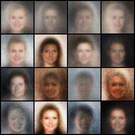</td>
    <td>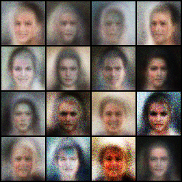</td>
    <td>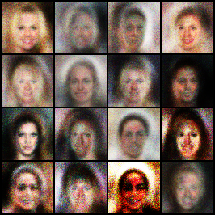</td>
    <td>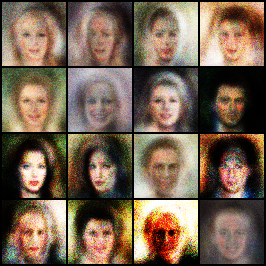</td>
    <td>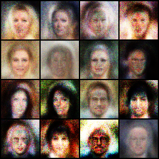</td>
  </tr>
</table>

> **Honest read of the results:** after epoch 1 the generator produces smooth, blurry "average face" blobs. By epoch 5 the faces have more variety (hair colour and shape, face outline, eyes and mouth) but also carry coloured noise and blur — the expected ceiling of a fully-connected GAN trained for only 5 epochs. No quantitative metric (FID or IS) has been computed yet. See [Results](#-results).

---

## 📑 Table of Contents

1. [Problem Statement](#-problem-statement) · 2. [Solution Overview](#-solution-overview) · 3. [Key Features](#-key-features)
4. [Architecture](#-architecture) · 5. [Technology Stack](#-technology-stack--complete-breakdown) · 6. [Request Lifecycle](#-request-lifecycle) · 7. [Data Flow](#-data-flow)
8. [UML Suite](#-uml-diagrams--full-suite) · 9. [DFDs](#-data-flow-diagrams) · 10. [Folder Structure](#-folder-structure)
11. [Getting Started](#-getting-started) · 12. [Configuration](#-configuration) · 13. [ML Pipeline](#-ml-pipeline) · 14. [Results](#-results)
15. [Engineering Decisions](#-engineering-decisions-and-tradeoffs) · 16. [Troubleshooting](#-troubleshooting) · 17. [Roadmap](#-roadmap-proposed) · 18. [Credits](#-credits-and-acknowledgements)

---

## 🎯 Problem Statement

Generative modelling asks a deceptively hard question: *given only a pile of examples (here, 202,599 celebrity face photos), can a program learn the underlying distribution well enough to produce new samples that were never in the data?*

Explicitly modelling the pixel distribution of faces is intractable — a 64×64 RGB image lives in a 12,288-dimensional space. Face-Forge explores the classic answer from Goodfellow et al. (2014): **do not model the density; train a sampler adversarially.**

## 💡 Solution Overview

Face-Forge implements the original GAN recipe end to end, with every moving part written by hand rather than hidden behind a framework:

- A **Generator** maps a 100-dimensional noise vector to a 64×64×3 image.
- A **Discriminator** scores an image as real (from CelebA) or fake (from the Generator).
- The two networks are trained in alternation: the Discriminator learns to tell them apart, and the Generator learns to fool it.
- The training loop is **resumable** (full checkpointing of weights, optimizer state, loss history and the fixed sample noise) and **observable** (periodic loss and `D(x)` / `D(G(z))` logging, a sample grid per epoch, loss curves at the end).

This repository is the "vanilla" baseline — fully-connected networks only — intended as the reference point for convolutional (DCGAN-style) upgrades. See the [Roadmap](#-roadmap-proposed).

## ✨ Key Features

| Feature | Details | Where |
|---|---|---|
| Custom `Dataset` | Lists, filters (`.jpg`/`.jpeg`/`.png`) and sorts image files deterministically; decodes to RGB on access | `dataset.py` → `ImageProcessor` |
| Preprocessing pipeline | `CenterCrop(178)` → `Resize((64, 64))` → `ToTensor` → `Normalize(0.5, 0.5)` (pixels in `[-1, 1]` to match the generator's `Tanh`) | Notebook, transforms cell |
| Fast, Windows-safe loading | 4 worker processes, `pin_memory`, `persistent_workers`; dataset class lives in a `.py` file so Windows workers can import it | `dataset.py`, `DataLoader` cell |
| MLP Generator / Discriminator | 100 → 256 → 512 → 1024 → 12,288 and 12,288 → 1024 → 512 → 256 → 1 | Notebook, `Generator` / `Discriminator` |
| Numerically safe loss | `BCEWithLogitsLoss` on raw logits (no sigmoid in the discriminator) | Notebook, loss cell |
| GAN stabilisers | One-sided label smoothing (real label = 0.9), Adam with `betas=(0.5, 0.999)`, `lr=2e-4` | Notebook, `train()` |
| Crash-safe checkpointing | Atomic write (`last.pth.tmp` → `os.replace`), plus a small generator-only file per epoch | `save_checkpoint()` |
| Resume anywhere | `RESUME = True` continues at the next epoch with identical optimizer state and sample noise | `load_checkpoint()` |
| Built-in diagnostics | Logs every 50 steps; `D(x)`, `D(G(z))` and both losses stored in `history` and plotted | `train()`, loss-curve cell |

---

## 🏗 Architecture

### Overall Architecture

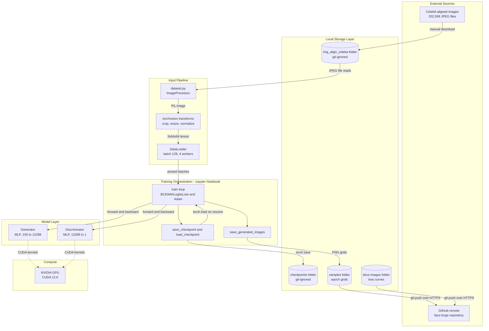

### System Architecture

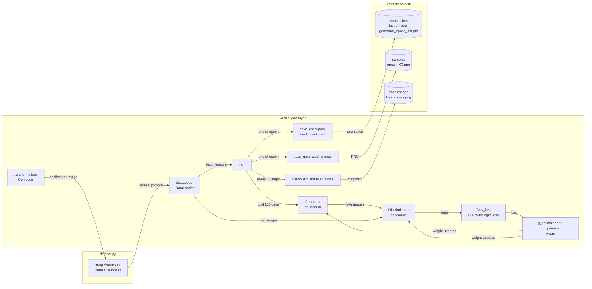

> Face-Forge is deliberately a **single-process research notebook**: there is no web server, API, database, authentication layer, frontend or container setup. Those layers are intentionally absent rather than "to be documented" — see [Scope](#-scope-whats-intentionally-not-here).

---

## 🧰 Technology Stack — Complete Breakdown

> Every library, framework and tool present in the project environment. There is no `requirements.txt` yet, so versions below were read from the project's `.venv` (Python 3.12.13, created with `uv`). Packages that are installed but not imported by any project code are marked explicitly.

### Core ML and Data

| Technology / Package | Version | Category | Purpose in Project | Why Chosen | Key Features Used |
|---|---|---|---|---|---|
| Python | 3.12.13 | Language | Everything: dataset code, models, training loop, plotting | De-facto language of ML research; the whole PyTorch ecosystem targets it | `os`, class definitions, f-strings, `os.replace` for atomic saves |
| PyTorch (`torch`) | 2.14.1+cu126 | Deep Learning Framework | Tensors, autograd, `nn.Module` networks, optimizers, loss, checkpoint serialization | Define-by-run autograd makes a hand-written GAN loop (two optimizers, `detach()`) easy to read and debug | `nn.Sequential`, `nn.Linear`, `nn.ReLU`, `nn.LeakyReLU(0.2)`, `nn.Tanh`, `nn.Flatten`, `nn.BCEWithLogitsLoss`, `optim.Adam`, `torch.manual_seed`, `torch.randn`, `torch.full`, `torch.no_grad`, `torch.save`, `torch.load`, `state_dict` |
| CUDA build (`cu126`) | 12.6 | GPU Runtime | Runs both networks on the NVIDIA GPU | The batch of 128 × 12,288-pixel images and ~26.5 M parameters train far faster on GPU than CPU | `torch.cuda.is_available()`, `.to(device)`, `non_blocking=True` copies |
| torchvision | 0.29.1+cu126 | Vision Utilities | Image preprocessing and sample-grid creation | Standard, GPU-agnostic transforms; saves writing crop/resize/normalize by hand | `transforms.Compose`, `CenterCrop`, `Resize`, `ToTensor`, `Normalize`, `utils.make_grid`, `utils.save_image` |
| Pillow | 13.0.0 | Image I/O | Decodes CelebA JPEGs inside `ImageProcessor.__getitem__` | The image backend torchvision transforms expect | `Image.open(...).convert("RGB")` |
| NumPy | 2.5.4 | Numerics | Dependency of PyTorch and Matplotlib | Array interop layer | Imported in the notebook (`import numpy as np`) but **not called directly** |
| Matplotlib | 3.11.2 | Visualization | Displays each epoch's sample grid and the final loss / confidence curves | Ubiquitous, notebook-native plotting | `pyplot.figure`, `imshow`, `plot`, `subplots`, `set_ylim`, `legend` |

### Notebook and Environment Tooling

| Technology / Package | Version | Category | Purpose in Project | Why Chosen | Key Features Used |
|---|---|---|---|---|---|
| JupyterLab | 4.6.5 | IDE | Interactive authoring and running of `vanilla_gan.ipynb` | Cell-by-cell execution suits experiment-driven GAN work; inline plots | Notebook UI, kernel management |
| Jupyter Notebook | 7.6.3 | IDE | Alternative notebook front end shipped with the `jupyter` meta-package | Same `.ipynb` format | — |
| ipykernel | 7.4.0 | Kernel | Python kernel the notebook runs on (kernelspec `.venv (3.12.13)`) | Binds the notebook to the project virtualenv | Kernel launch |
| `jupyter` meta-package | 1.1.1 | Tooling | Pulls in the Jupyter component set | One-line install | — |
| uv | 0.11.23 | Package / Env Manager | Created the virtualenv (recorded in `.venv/pyvenv.cfg`) | Much faster than `pip`/`venv`; one tool for Python + venv + installs | `uv venv`, `uv pip install` |
| Git | — | Version Control | Tracks code and samples; this repo is a submodule of the AIML parent repo | Required for the submodule workflow | `git submodule add`, `.gitignore` for large artifacts |
| tqdm | 4.70.1 | Progress Bars | Installed in `.venv` as a Jupyter dependency | — | **Not imported** by project code |
| torchaudio | 2.11.0+cu126 | Audio Library | Installed alongside torch | — | **Not imported** by project code (safe to omit) |

### Hardware Used

| Component | Value | Evidence |
|---|---|---|
| GPU | NVIDIA GeForce RTX 3050 6GB Laptop GPU | Notebook output, device-info cell |
| Training time | ≈ 12–15 minutes per epoch | *Inferred from `generator_epoch_XX.pth` file timestamps* |

---

## 🔄 Request Lifecycle

Face-Forge has no HTTP requests, so the equivalent unit of work is the **training step** (the "read + compute" path) and the **checkpoint save / resume** cycle (the "write" path). Each is traced below with real files, cells and functions.

### Trace 1 — One Training Step (`train()` in the notebook)

```
1. BATCH FETCH  (read path, data layer)
   └── for i, imgs in enumerate(dataLoader)            [notebook: train()]
       → DataLoader (batch_size=128, shuffle=True, 4 persistent workers)
       → each worker calls ImageProcessor.__getitem__(idx)   [dataset.py]
            • Image.open(path).convert("RGB")
            • transformations: CenterCrop(178) → Resize((64,64))
                               → ToTensor() → Normalize(0.5, 0.5)
            • returns a 3x64x64 tensor with values in [-1, 1]
       → default collate stacks 128 tensors → [128, 3, 64, 64]
       → pin_memory=True places the batch in page-locked RAM
       → imgs.to(device, non_blocking=True) copies it to the GPU

2. LABELS
   └── real_labels = full((B,1), 0.9)   ← one-sided label smoothing
       fake_labels = zeros((B,1))
       B = real_imgs.size(0), so the final short batch of an epoch is handled

3. DISCRIMINATOR UPDATE
   └── d_optimizer.zero_grad()
       fake_imgs = generator(randn(B, 100))            → [B, 3, 64, 64], Tanh range
       real_scores = discriminator(real_imgs)          → [B, 1] raw logits
       fake_scores = discriminator(fake_imgs.detach()) ← detach: no gradient into G
       d_loss = (BCEWithLogits(real_scores, 0.9) + BCEWithLogits(fake_scores, 0)) / 2
       d_loss.backward(); d_optimizer.step()

4. GENERATOR UPDATE
   └── g_optimizer.zero_grad()
       g_loss = BCEWithLogits(discriminator(fake_imgs), ones)  ← G wants "real"
       g_loss.backward(); g_optimizer.step()
       (D is evaluated with its *already updated* weights; only G's optimizer steps)

5. LOGGING   (every 50th step: i % 50 == 0 → 32 log points per epoch)
   └── d_real = sigmoid(real_scores).mean();  d_fake = sigmoid(fake_scores).mean()
       appended to history{step, d_loss, g_loss, d_real, d_fake}
       printed: "Epoch [e/5], Step [i/1583], D Loss, G Loss, D(x), D(G(z))"

6. END OF EPOCH
   └── save_generated_images(generator, epoch, fixed_noise)  → samples/epoch_XX.png
       save_checkpoint(LAST_CKPT, epoch, ...)               → see Trace 2
```

**Error / failure path**

| Failure | Where it surfaces | Cause | Handling in this repo |
|---|---|---|---|
| `Can't get attribute 'ImageProcessor' on <module '__main__'>` | DataLoader worker start-up on Windows | Dataset class defined inside a notebook cell cannot be re-imported by spawned workers | Class moved to `dataset.py` |
| `G Loss: 100.0000`, `D(G(z))` pinned at `0.00` | Training logs | `Sigmoid` + `BCELoss` clamps `log(0)` to −100, so G's gradient becomes exactly zero | Sigmoid removed from D; `BCEWithLogitsLoss` used |
| Empty dataset (`len == 0`) | `ImageProcessor` | `img_align_celeba` extracted into a nested sub-folder; non-image entries are filtered out | See [Troubleshooting](#-troubleshooting) |
| Half-written checkpoint after a crash | `last.pth` | Process killed mid-`torch.save` | Write to `last.pth.tmp`, then atomic `os.replace` |

### Trace 2 — Checkpoint Save and Resume (write path and recovery path)

```
SAVE   save_checkpoint(path, epoch, generator, discriminator,
                       g_optimizer, d_optimizer, fixed_noise, history)
   1. Build dict: epoch, generator, discriminator, g_optimizer, d_optimizer,
                  fixed_noise, history   (all state_dict()s or plain Python/tensor values)
   2. torch.save(dict, "checkpoints/last.pth.tmp")        ~318 MB
   3. os.replace(tmp, "checkpoints/last.pth")             atomic swap
   4. torch.save(generator.state_dict(),
                 "checkpoints/generator_epoch_{epoch+1:02d}.pth")   ~53 MB, weights only

RESUME  (RESUME = True and last.pth exists)
   1. load_checkpoint(path, ...) → torch.load(path, map_location=device)
   2. load_state_dict() into generator, discriminator, g_optimizer, d_optimizer
   3. start_epoch = checkpoint["epoch"] + 1               continue with the NEXT epoch
   4. fixed_noise and history are restored → sample grids stay comparable,
      loss curves continue from the same step counter
```

### Trace 3 — Sample Generation (inference path)

```
save_generated_images(generator, epoch, noise)
   1. with torch.no_grad(): generator(fixed_noise).cpu()    noise: [16, 100]
   2. Generator.forward: Linear(100→256) ReLU → Linear(256→512) ReLU
        → Linear(512→1024) ReLU → Linear(1024→12288) Tanh
        → img.view(B, 3, 64, 64)
   3. torchvision.utils.make_grid(imgs, nrow=4, normalize=True)   [-1,1] → [0,1]
   4. torchvision.utils.save_image(grid, "samples/epoch_XX.png")
   5. plt.imshow(grid.permute(1, 2, 0))   (C,H,W) → (H,W,C) for display
```

---

## 🌊 Data Flow

### Tensor Shapes at Every Stage

| Stage | Shape / Range | Transformation and Why |
|---|---|---|
| CelebA JPEG on disk | aligned face photo (178×218 px in the standard release) | Source data |
| After `CenterCrop(178)` | 178×178 | Makes the image square, removing the extra height so the face is not distorted by resizing |
| After `Resize((64, 64))` | 64×64 | Shrinks the problem to 12,288 values per image; trainable on a 6 GB laptop GPU |
| After `ToTensor()` | `[3, 64, 64]`, `[0, 1]` | Channels-first float tensor |
| After `Normalize(0.5, 0.5)` | `[3, 64, 64]`, `[-1, 1]` | Matches the generator's `Tanh` output range, so real and fake images share a range |
| After `DataLoader` | `[128, 3, 64, 64]` (last batch: 103) | 202,599 = 1,582 × 128 + 103 → **1,583 steps per epoch** |
| Discriminator input | `nn.Flatten` → `[B, 12288]` | MLP needs a vector, so all spatial structure is discarded (the vanilla GAN's key limitation) |
| Discriminator output | `[B, 1]` raw logit | No sigmoid; applied inside `BCEWithLogitsLoss` |
| Generator input | `[B, 100]`, `N(0, 1)` | Latent noise `z` |
| Generator output | `[B, 12288]` → `view` → `[B, 3, 64, 64]`, `[-1, 1]` | Reshaped back into an image |
| Saved sample grid | `[3, H, W]`, `[0, 1]` | `make_grid(normalize=True)` maps `[-1, 1]` back to `[0, 1]` for viewing |

### Component Interaction Flow

```
CelebA JPEGs → ImageProcessor (dataset.py) → torchvision transforms → DataLoader workers
   → pinned batch → GPU → Discriminator (real branch)
Random z → Generator → fake batch → Discriminator (fake branch)
   → BCEWithLogitsLoss → Adam updates (D first, then G)
   → every 50 steps: history + console log
   → end of epoch: sample grid PNG + last.pth + generator_epoch_XX.pth
```

### Training-State Management Flow

There is no application state store; the "state" is the training state held in notebook variables and persisted by checkpoints.

```
In memory                      Persisted in checkpoints/last.pth
─────────                      ─────────────────────────────────
generator.state_dict()      →  "generator"
discriminator.state_dict()  →  "discriminator"
g_optimizer.state_dict()    →  "g_optimizer"     (Adam moving averages per weight)
d_optimizer.state_dict()    →  "d_optimizer"
fixed_noise [16, 100]       →  "fixed_noise"     (same 16 faces every epoch)
history{step, d_loss, ...}  →  "history"
epoch (last completed)      →  "epoch"
```

### Error Propagation

Errors are not caught — they propagate as ordinary Python exceptions into the notebook cell output. Because a checkpoint is written after every epoch, the worst-case loss after any failure is **one epoch of progress**. Re-run the cells and the resume cell restores state.

### Caching

There is no cache layer. The only reuse mechanisms are `persistent_workers=True` (worker processes survive across epochs instead of restarting) and the generator-only files that let you sample without re-loading the 318 MB full checkpoint.

---

## 📐 UML Diagrams — Full Suite

<details>
<summary>📐 UML Diagrams — Full Suite (9 Diagrams + Swimlane)</summary>

### UML 1 — Use Case Diagram

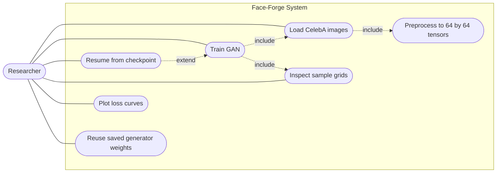

### UML 2 — Class Diagram

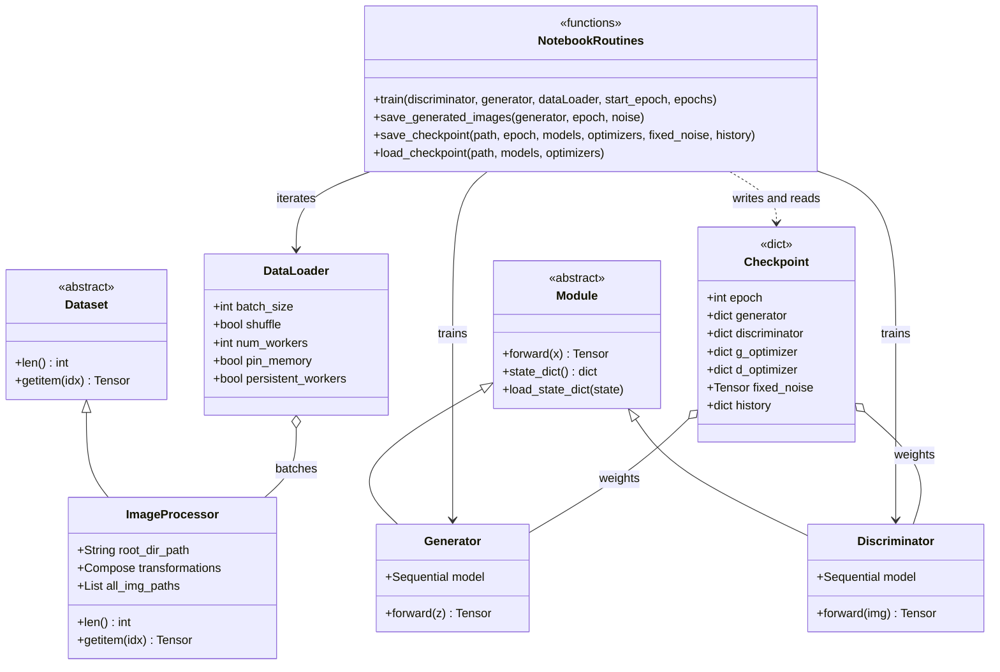

### UML 3 — Sequence Diagram (one training step)

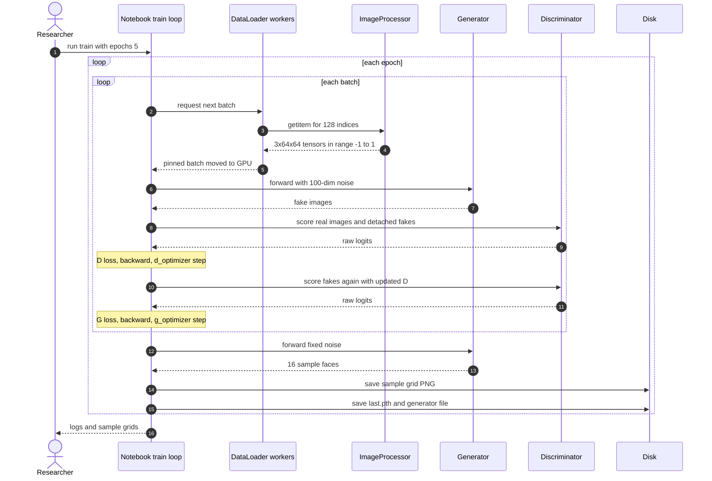

### UML 4 — Collaboration Diagram

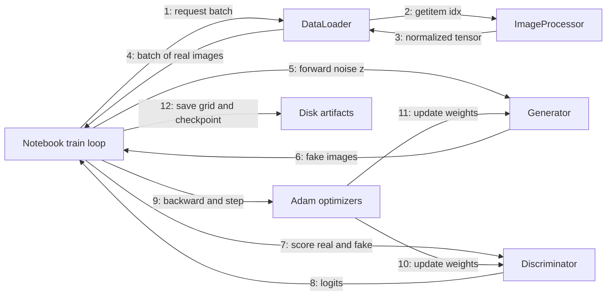

### UML 5 — Activity Diagram

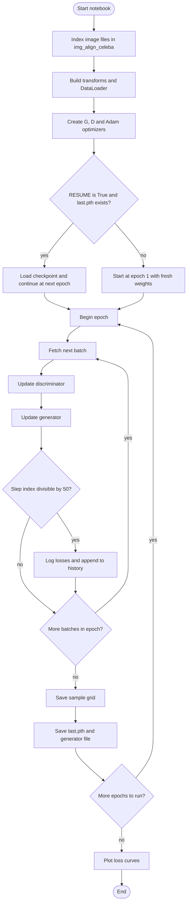

### UML 6 — State Diagram (training run lifecycle)

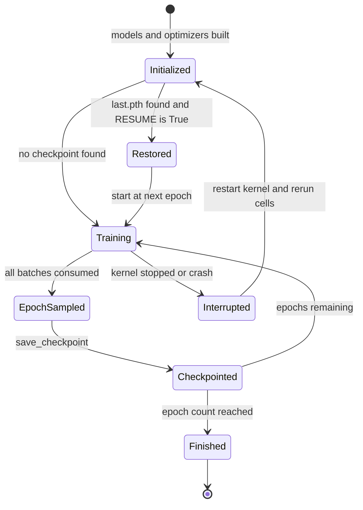

### UML 7 — Component Diagram

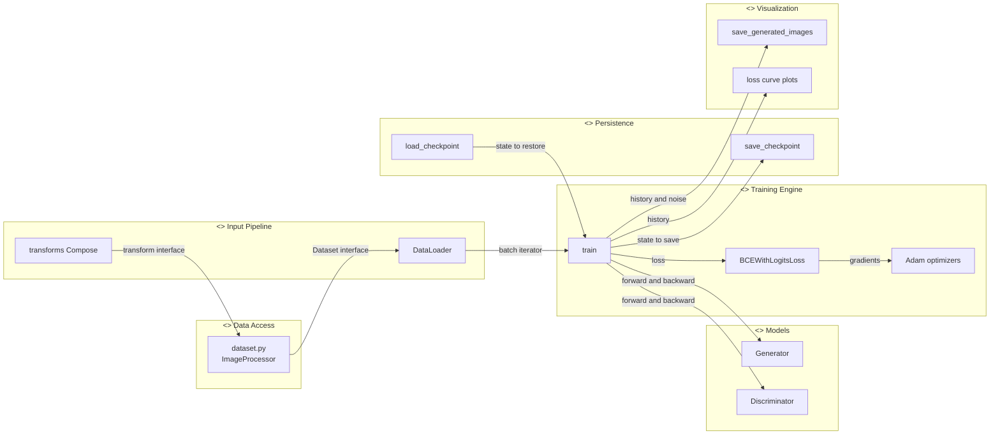

### UML 8 — Deployment Diagram

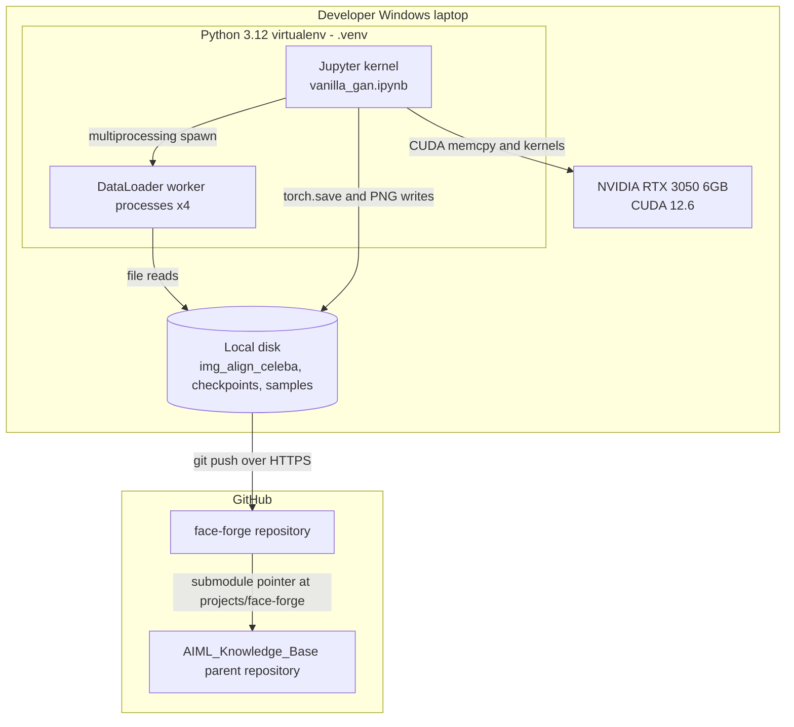

### UML 9 — Package Diagram

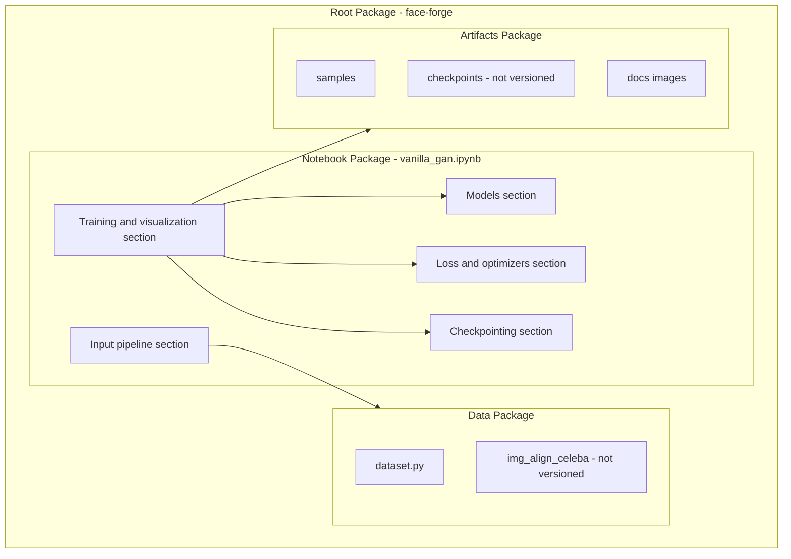

### Swimlane Diagram — One Epoch Across Actors

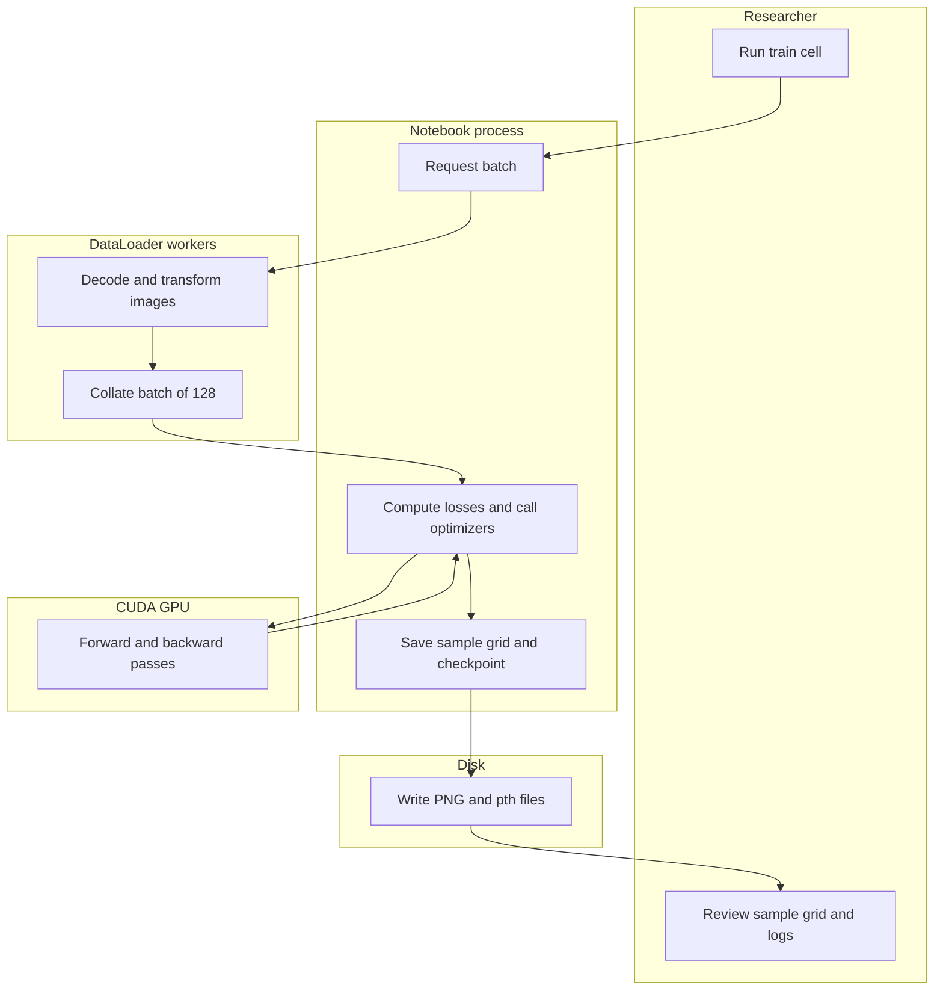

</details>

---

## 📊 Data Flow Diagrams

<details>
<summary>📊 Data Flow Diagrams — Level 0 and Level 1</summary>

### DFD Level 0 — Context Diagram


### DFD Level 1 — System Diagram

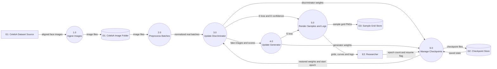

</details>

---

## 📁 Folder Structure

```
face-forge/
├── README.md                   # This document
├── dataset.py                  # ImageProcessor (torch Dataset) — kept out of the notebook so
│                               #   Windows DataLoader workers can import it
├── vanilla_gan.ipynb           # The whole experiment: data → models → loss → checkpoints → training → plots
├── .gitignore                  # Ignores dataset, checkpoints, venvs, caches
├── samples/                    # epoch_01.png … epoch_05.png — 4×4 grids from the SAME fixed noise
├── docs/
│   └── images/
│       └── loss_curves.png     # Loss and discriminator-confidence curves from the final notebook cell
│
│   # --- present locally, intentionally NOT in git ---
├── img_align_celeba/           # 202,599 CelebA JPEGs (dataset, you download this)
├── checkpoints/                # last.pth (~318 MB) + generator_epoch_XX.pth (~53 MB each)
├── .venv/                      # uv-managed virtual environment (Python 3.12)
└── __pycache__/ · .ipynb_checkpoints/
```

---

## 🚀 Getting Started

### Prerequisites

| Requirement | Notes |
|---|---|
| Python 3.12 | The project was built and run on 3.12.13 |
| NVIDIA GPU + driver supporting CUDA 12.6 *(recommended)* | Developed on an RTX 3050 6 GB laptop GPU. CPU works but is much slower |
| [`uv`](https://docs.astral.sh/uv/) *(or `pip`)* | The project's `.venv` was created with `uv` |
| CelebA aligned images | Download `img_align_celeba` from the [official CelebA page](https://mmlab.ie.cuhk.edu.hk/projects/CelebA.html) (or a mirror such as Kaggle) |
| Git | To clone; submodule support if you use the parent repo |

### Installation

```bash
# 1. Clone (standalone)
git clone https://github.com/KARTHIKAKRISHNA123/face-forge.git
cd face-forge

# 2. Create and activate a virtual environment
uv venv --python 3.12
source .venv/Scripts/activate        # Git Bash on Windows
# .venv\Scripts\Activate.ps1         # PowerShell
# source .venv/bin/activate          # Linux or macOS

# 3. Install PyTorch (CUDA 12.6 build) — drop the --index-url for a CPU-only install
uv pip install torch torchvision --index-url https://download.pytorch.org/whl/cu126

# 4. Install the remaining libraries
uv pip install pillow matplotlib numpy jupyterlab ipykernel
```

**If you cloned the AIML parent repo instead** (this project is a submodule there):

```bash
git clone --recurse-submodules https://github.com/KARTHIKAKRISHNA123/AIML_Knowledge_Base.git
# or, in an existing clone:
git submodule update --init projects/face-forge
```

### Add the Dataset

Extract the images so the JPEGs sit **directly** inside `img_align_celeba/`:

```
face-forge/img_align_celeba/000001.jpg
face-forge/img_align_celeba/000002.jpg
...                                   (202,599 files in total)
```

> ⚠️ Some downloads unzip to `img_align_celeba/img_align_celeba/…`. Flatten that, otherwise `ImageProcessor` finds zero images (it ignores sub-folders).

### Run

```bash
jupyter lab
```

Open `vanilla_gan.ipynb` and **Run All**. With `RESUME = True` it continues from `checkpoints/last.pth` if one exists; otherwise it starts fresh. Expect roughly 12–15 minutes per epoch on an RTX 3050 6 GB laptop GPU.

**Train longer:** restart the kernel, run every cell (keep `RESUME = True`) and raise `epochs` in the final training cell. With `epochs=8` it continues with epochs 6, 7 and 8.

### Generate Faces from a Saved Generator

> ℹ️ *Usage snippet derived from the checkpoint format in `save_checkpoint()`; the repo does not ship a standalone generation script yet.* Run it in the notebook after the `Generator` cell has been executed.

```python
generator = Generator().to(device)
generator.load_state_dict(torch.load("checkpoints/generator_epoch_05.pth", map_location=device))
generator.eval()

with torch.no_grad():
    faces = generator(torch.randn(16, 100, device=device)).cpu()

grid = torchvision.utils.make_grid(faces, nrow=4, normalize=True)
plt.imshow(grid.permute(1, 2, 0)); plt.axis("off"); plt.show()
```

---

## ⚙️ Configuration

There are **no environment variables or config files**. All settings are constants in the notebook:

| Setting | Value | Location | Purpose |
|---|---|---|---|
| `root_dir_path` | `"./img_align_celeba"` | Dataset cell | Image folder |
| Crop / resize | `CenterCrop(178)`, `Resize((64, 64))` | Transforms cell | Square-crop then downscale |
| `batch_size` | `128` | `DataLoader` | 1,583 steps per epoch |
| `num_workers` | `4` | `DataLoader` | Parallel JPEG decoding (the real bottleneck) |
| `pin_memory` / `persistent_workers` | `True` / `True` | `DataLoader` | Faster host→GPU copies / no worker restart per epoch |
| `z_dim` | `100` | `Generator` | Latent vector size |
| Learning rate / betas | `2e-4` / `(0.5, 0.999)` | Optimizer cell | Standard GAN Adam setup (both networks) |
| Real-label value | `0.9` | `train()` | One-sided label smoothing |
| Fixed noise | `torch.randn(16, 100)` with seed `0` | Resume cell | Comparable sample grids across epochs |
| Model-init seed | `torch.manual_seed(42)` | Model cell | Reproducible initial weights |
| `CHECKPOINT_DIR` / `SAMPLES_DIR` | `"checkpoints"` / `"samples"` | Checkpoint cell | Output folders |
| `RESUME` | `True` | Resume cell | Continue from `last.pth` if present |
| `epochs` | `5` | Train cell | Total epochs to reach |
| Log interval | every `50` steps | `train()` | 32 log points per epoch |

---

## 🧠 ML Pipeline

### Dataset

[CelebA](https://mmlab.ie.cuhk.edu.hk/projects/CelebA.html) — 202,599 aligned celebrity face images. Only the images are used: `ImageProcessor.__getitem__` returns the tensor alone, with **no labels or attribute annotations**, so training is fully unsupervised.

### Model Architecture

| | Generator | Discriminator |
|---|---|---|
| Input | `z ∈ ℝ¹⁰⁰` ~ N(0, 1) | image `[3, 64, 64]` (flattened to 12,288) |
| Layers | `Linear 100→256`, ReLU, `256→512`, ReLU, `512→1024`, ReLU, `1024→12288`, Tanh | `Linear 12288→1024`, LeakyReLU(0.2), `1024→512`, LeakyReLU(0.2), `512→256`, LeakyReLU(0.2), `256→1` |
| Output | `[B, 3, 64, 64]` in `[-1, 1]` | `[B, 1]` raw logit |
| Parameters | ≈ 13.28 M | ≈ 13.24 M |

> Parameter counts were computed from the layer shapes and cross-checked against checkpoint sizes (`generator_epoch_XX.pth` ≈ 53 MB; `last.pth` ≈ 318 MB = both networks + two Adam states).

### Training Procedure

Each step performs one discriminator update followed by one generator update (1:1 ratio):

- **Discriminator loss:** `½ · [ BCE(D(x), 0.9) + BCE(D(G(z)), 0) ]` — real images are labelled `0.9` (one-sided label smoothing) so D cannot become 100 % certain.
- **Generator loss (non-saturating form):** `BCE(D(G(z)), 1)` — G maximises the chance that D calls its fakes real, which keeps gradients alive early in training.
- **Optimizers:** two independent `Adam(lr=2e-4, betas=(0.5, 0.999))`.
- **Schedule:** 5 epochs × 1,583 steps = 7,915 steps.

### How to Read the Logs

`D(x)` is how sure D is that real images are real; `D(G(z))` is how sure D is that fakes are real. Healthy training wobbles at roughly `D(x)` 0.5–0.9 and `D(G(z))` 0.1–0.5. If `D(G(z))` stays at `0.00` for hundreds of steps, D has won and G has stopped learning — stop and fix it.

---

## 📈 Results

### Loss and Discriminator Confidence

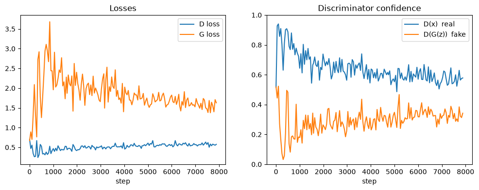

Per-epoch averages over the 32 logged steps in each epoch (every 50th step), taken from the notebook's training output:

| Epoch | D loss | G loss | D(x) real | D(G(z)) fake |
|:---:|:---:|:---:|:---:|:---:|
| 1 | 0.432 | 2.119 | 0.763 | 0.248 |
| 2 | 0.488 | 2.027 | 0.653 | 0.271 |
| 3 | 0.522 | 1.876 | 0.623 | 0.294 |
| 4 | 0.563 | 1.700 | 0.592 | 0.328 |
| 5 | 0.572 | 1.587 | 0.572 | 0.327 |

**What the curves show**

- **Early instability, then recovery.** Around step ~300 the discriminator briefly dominates (`D(G(z))` dips to ≈ 0.03 while G loss spikes toward ≈ 3.7), then the generator catches up.
- **Convergence towards balance.** `D(x)` drifts down from ≈ 0.76 to ≈ 0.57 while `D(G(z))` rises from ≈ 0.25 to ≈ 0.33 — the two networks end in the "healthy" band the notebook defines, with no collapse to `0.00` or `100.0000`.
- **Caveat.** Balanced losses do not by themselves prove sample quality or diversity; GAN losses are famously weak quality indicators.

### Generated Samples

<p align="center">
  
</p>

*Epoch 5, 16 faces from fixed noise. Face structure and hair are recognisable; blur and coloured noise remain.*

### Current Limitations

- A fully-connected network ignores spatial structure — it cannot share filters across the image, which is why convolutional GANs (DCGAN) are the usual next step.
- Only 5 epochs have been trained.
- No FID / IS evaluation; judged visually only.
- No mode-collapse or diversity analysis.

---

## 🔐 Security Considerations

| Concern | Status |
|---|---|
| Secrets / credentials | None used or stored; no network calls at runtime |
| Untrusted checkpoints | `torch.load` unpickles data — only load `.pth` files you created or trust |
| Large binaries in git | `checkpoints/` is git-ignored (`last.pth` at ≈ 318 MB would exceed GitHub's 100 MB file limit) |
| Dataset licensing | CelebA is distributed for **non-commercial research use**; the images are not redistributed here (`img_align_celeba/` is git-ignored) |
| Responsible use | A face generator can be misused for deceptive media; samples here are low-fidelity research artefacts, and any derivative work should label synthetic imagery as such |

## ⚡ Performance Optimizations

- **Parallel decoding:** JPEG decoding, not the GPU, is the bottleneck — hence `num_workers=4`.
- **`persistent_workers=True`:** avoids re-spawning workers each epoch (slow on Windows).
- **`pin_memory=True` + `non_blocking=True`:** overlaps host→GPU copies with compute.
- **`detach()` on the D step:** the generator graph is not back-propagated when only D is updated.
- **Slim notebook:** the 202,599-name `os.listdir` printout was replaced with a 5-item peek (it had bloated the notebook to ~10 MB).

## 📏 Scalability Design

This is a single-GPU, single-process experiment. It scales *up* simply (larger `batch_size`, more epochs via resume) but not *out*. Moving to higher resolution or bigger models would first require convolutional architectures and mixed precision — see the [Roadmap](#-roadmap-proposed).

## 🧪 Testing, Error Handling and Logging

| Area | Current state |
|---|---|
| Testing | No automated tests. Correctness is checked visually (sample grids) and numerically (loss and `D(x)` / `D(G(z))` ranges) |
| Error handling | Exceptions propagate to the notebook; recovery is via per-epoch checkpoints and atomic writes |
| Logging | `print` every 50 steps plus the in-memory `history` dict; plotted at the end |

## 🧭 Scope — What's Intentionally Not Here

Face-Forge is a research notebook, so these usual README sections do not apply and are deliberately omitted rather than padded out:

| Layer | Status |
|---|---|
| REST API / endpoints | None |
| Database / schema | None — data is a folder of image files |
| Authentication | None |
| Frontend / component architecture | None — plots render inline in Jupyter |
| Docker | No `Dockerfile` |
| CI/CD | No workflow files |

---

## 🧩 Engineering Decisions and Tradeoffs

| Decision | Why | Tradeoff |
|---|---|---|
| `ImageProcessor` in `dataset.py`, not the notebook | On Windows, DataLoader workers are fresh processes that cannot see classes defined in notebook cells (`Can't get attribute 'ImageProcessor' …`). A module file lets `num_workers > 0` work | One extra file; notebook is no longer fully self-contained |
| `BCEWithLogitsLoss`, no sigmoid in D | `Sigmoid` + `BCELoss` rounds to exactly 0.0 in float32 when D is confident, `BCELoss` clamps `log(0)` at −100 (the **G Loss 100.0** symptom) and G's gradient becomes zero | D outputs logits; a sigmoid must be applied manually when a probability is needed (as done for logging) |
| Label smoothing (real = 0.9) | Stops D becoming 100 % sure and starving G of useful gradients | Slightly biases D's calibration |
| Both optimizers built in one cell with `betas=(0.5, 0.999)` | An earlier version created the optimizers in a second cell that silently dropped `betas` | Re-running the cell resets the networks — intended, but easy to forget |
| `fixed_noise` stored in the checkpoint | Sample grids stay comparable across epochs *and* across resumed sessions | Slightly larger checkpoint |
| Atomic checkpoint write (`.tmp` + `os.replace`) | A crash mid-save cannot corrupt `last.pth` | Briefly needs ~2× checkpoint disk space |
| Two checkpoint types | `last.pth` (~318 MB) resumes training; `generator_epoch_XX.pth` (~53 MB) lets you sample and compare epochs cheaply | More files on disk |
| MLP instead of CNN | Keeps the baseline minimal and educational: the pure GAN idea with no architectural tricks | Blurry, noisy faces; no spatial inductive bias |

---

## 🛠 Troubleshooting

| Symptom | Likely cause | Fix |
|---|---|---|
| `Total images in dataset: 0` | Images nested in `img_align_celeba/img_align_celeba/` or wrong path | Move the JPEGs directly into `./img_align_celeba/` |
| `Can't get attribute 'ImageProcessor' on <module '__main__'>` | Dataset class redefined inside the notebook while `num_workers > 0` on Windows | Import it: `from dataset import ImageProcessor` |
| `Using device: cpu` | CPU-only PyTorch build or no CUDA driver | Reinstall with the `cu126` index URL; check `torch.cuda.is_available()` |
| CUDA out of memory | GPU has less than ~6 GB free | Lower `batch_size` (e.g. 64) |
| `G Loss: 100.0000`, `D(G(z))` stuck at 0.00 | D has overpowered G (sigmoid saturation) | Use `BCEWithLogitsLoss` with a logit-output D (already the case here); restart training |
| Training restarts from epoch 1 unexpectedly | `RESUME = False`, or `checkpoints/last.pth` missing | Set `RESUME = True`, check the file exists |
| Resumed run behaves differently | Models/optimizers rebuilt after the resume cell | Run the resume cell **immediately before** the train cell |
| Notebook is many MB | Printed the full file list or kept large outputs | Print only a slice (`os.listdir(...)[:5]`) |
| `git push` rejected, file too large | Tried to commit `last.pth` | Keep `checkpoints/` in `.gitignore`; use Git LFS or a Hugging Face repo if you want to share weights |

## ❓ FAQ

**Why is the image quality low?** A fully-connected GAN treats an image as a flat vector of 12,288 numbers and cannot exploit local structure. Five epochs is also very short. Convolutional layers and longer training are the standard remedies.

**Why 64×64 and a 178 crop?** CelebA aligned images are 178×218; cropping to 178×178 keeps the face undistorted, and 64×64 keeps training feasible on a 6 GB laptop GPU.

**Why does `D(G(z))` start at ~0.5 and then drop?** Early on D cannot tell real from fake; it quickly learns obvious artefacts, then G adapts. The dip near step ~300 is that first adversarial swing.

**Can I resume after Ctrl+C?** Yes. Restart the kernel, run all cells with `RESUME = True`; you lose at most the epoch in progress.

**Where are the trained weights?** Locally in `checkpoints/` (git-ignored because of file size).

---


## 🤝 Contributing

Issues and pull requests are welcome. For a change to the model or training loop, please include before/after sample grids (same `fixed_noise`) and the loss curves so the effect is visible.

1. Fork the repository and create a feature branch
2. Keep large artefacts (`checkpoints/`, datasets) out of git
3. Open a pull request describing what changed and why


## 🙏 Credits and Acknowledgements

- **Author:** Karthika Krishna M ([@KARTHIKAKRISHNA123](https://github.com/KARTHIKAKRISHNA123))
- **Method:** I. Goodfellow et al., *Generative Adversarial Nets*, NeurIPS 2014
- **Dataset:** Z. Liu, P. Luo, X. Wang, X. Tang, *Deep Learning Face Attributes in the Wild*, ICCV 2015 — [CelebA](https://mmlab.ie.cuhk.edu.hk/projects/CelebA.html), Multimedia Laboratory, The Chinese University of Hong Kong
- **Frameworks:** [PyTorch](https://pytorch.org/), [torchvision](https://pytorch.org/vision/), [Matplotlib](https://matplotlib.org/), [Pillow](https://python-pillow.org/), [Jupyter](https://jupyter.org/)
- **Part of:** the [AIML_Knowledge_Base](https://github.com/KARTHIKAKRISHNA123/AIML_Knowledge_Base) learning portfolio (included as a Git submodule under `projects/face-forge`)
